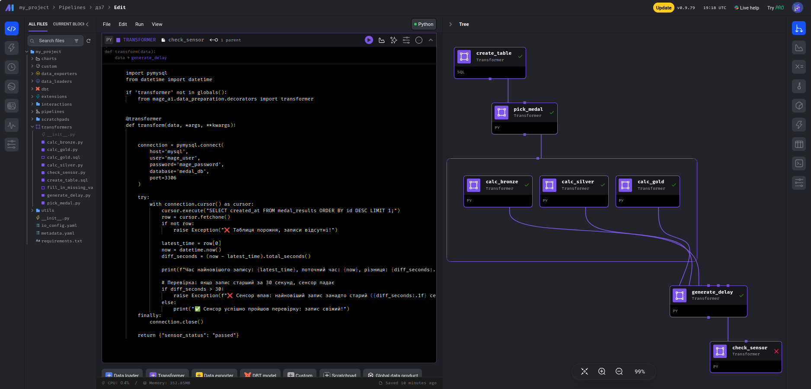
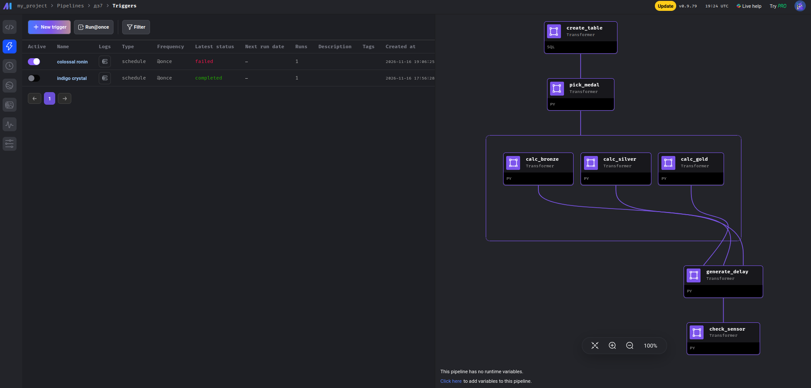
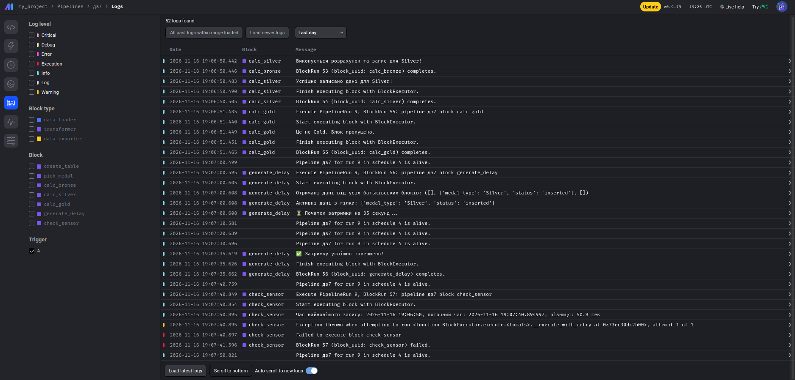

# Домашнє завдання до теми “Apache Airflow”

## 📋 Звіт про виконання міграції пайплайну (Medal Calculation Workflow) з Apache Airflow на **Mage AI**

### 1. Архітектура та інфраструктура

* **Середовище виконання**: Розгорнуто та налаштовано роботу Mage AI у зв'язці з контейнером **MySQL 8.0** через Docker-compose.

* **Структура DAG**: Побудовано повноцінний граф (DAG) із лінійним початком, умовним розгалуженням (fan-out), об'єднанням потоків (fan-in) та фінальною перевіркою сенсором.

---

### 2. Покрокова реалізація компонентів

**Етап 1: Ініціалізація та тестові дані (`create_table`)**

* Створено SQL-блок, який автоматично готує структуру бази даних.

* Реалізовано безпечне перестворення таблиць (`DROP TABLE IF EXISTS`), що усунуло конфлікти зі схемами.

* Створено та наповнено локальну тестову таблицю-джерело `athlete_event_results` та цільову таблицю `medal_results` із полями `id`, `medal_type`, `count` та `created_at`.

**Етап 2: Випадковий вибір (`pick_medal`)**

* Створено Python-трансформер, який за допомогою функції `random.choice(['Bronze', 'Silver', 'Gold'])` випадковим чином обирає категорію медалі для поточного запускa.

**Етап 3: Умовне розгалуження (Fan-out: `calc_bronze`, `calc_silver`, `calc_gold`)**

* Замість нестабільних декораторів умов налаштовано гнучкі Python-трансформери.

* Кожний блок перевіряє вхідне значення; якщо воно збігається з його цільовою медаллю, виконується SQL-запит на підрахунок кількості записів через `COUNT(*)` і запис результату в `medal_results`. Якщо ні — блок коректно пропускає виконання (повертаючи порожній список).

**Етап 4: Об'єднання потоків та затримка (Fan-in: `generate_delay`)**

* Налаштовано зв'язок блоку від усіх трьох попередніх гілок.

* За допомогою аргументу `*args` та ітерації з фільтрацією (`if item:`) реалізовано автоматичне знаходження активного результату в обхід порожніх списків від пропущених гілок.

* Встановлено штучну затримку `time.sleep(35)` відповідно до вимог тестування механізму "fail-fast".

**Етап 5: Сенсор перевірки свіжості даних (`check_sensor`)**

* Реалізовано перевірку часу найновішого запису в базі даних відносно поточного часу.

* Завдяки 35-секундній затримці та 30-секундному порогу спрацьовує захисний механізм, який підтверджує коректність «падіння» сенсора при затримці запису.

---

### Знімки UI **Mage AI**

#### Pipeline

#### Журнал виконання тригерів 

#### Log перевірки падіння сенсора

### 🎯 Підсумок

Міграція успішно завершена. Пайплайн повністю автономний, ізольований від зовнішніх залежностей завдяки локальному генератору тестових даних, коректно обробляє умовні розгалуження та зведення результатів.
